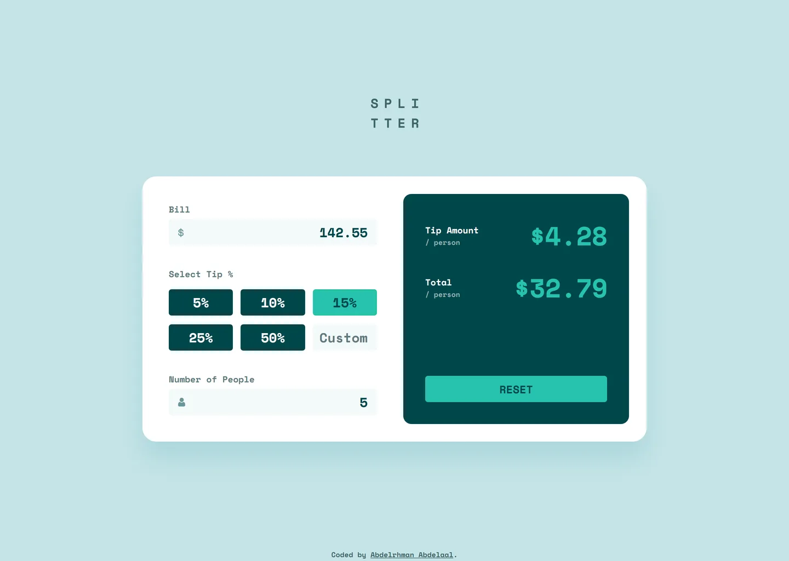

# Tip calculator app

My solution to the [Tip calculator app](https://www.frontendmentor.io/challenges/tip-calculator-app-ugJNGbJUX)
challenge on Frontend Mentor.

- Live: https://tip-calculator-app.abdelrhman-ahmed8881.workers.dev
- Code: https://github.com/MrBlackvanta/tip-calculator-app

## Built with

- Next.js 16, App Router
- React 19 and TypeScript
- Tailwind CSS v4

## Notes

### Colour

Three failures, measured against the backdrop each colour actually sits on rather than
against white:

|                                       | design     | built     | contrast     |
| ------------------------------------- | ---------- | --------- | ------------ |
| `/ person` sublabel on the dark panel | `#7F9D9F`  | `#97B0B1` | 3.61 to 4.57 |
| "Can't be zero"                       | `#E17457`  | `#CE4825` | 3.07 to 4.59 |
| Placeholders and the `$` icons        | ink at 35% | `#6B979B` | 1.92 to 3.03 |

The `Custom` placeholder also changed, but that one wasn't a failure. The design spends a
one-off grey on that single placeholder, and reusing an existing token costs 0.2 of a ratio
that only has to clear 3.0, since 24px bold counts as large text.

The design has no hover, focus or disabled states, so those are additions rather than
deviations.

### Layout

The file has a 375 frame and a 1440 frame and nothing between. Below 640px the sheet is
full-bleed with only its top corners rounded, as the mobile design draws it. From 640 it
becomes a centred 480px card, and the two-column desktop layout starts at 1024.

The results panel aligns with the fields above it at 32px, where the design insets it 24.
The desktop block is centred in the viewport rather than pinned to the design's y, so it
never clips on a short window.

The `Custom` cell keeps the design's 17px right padding and drops the left to 8px. The
design's 15px right padding is about 3px less than the placeholder's ink needs at this
column width, and the left padding is invisible behind right-aligned text.

### Behaviour

**Rounding.** The completed mock is internally inconsistent: from the same inputs it shows
a truncated tip and a rounded total, and no single rule produces both. I rounded both, so
the tip reads $4.28 where the mock reads $4.27.

**Amounts the design never sized.** Each amount is a fixed box in the file and the bill is
unbounded. An amount that no longer fits beside its label drops to its own line, still
right-aligned and complete; one wider than the panel is ellipsized with the full value in
`title`. Nothing overflows the card from 320px up.

## Author

- [LinkedIn](https://www.linkedin.com/in/abdelrhman-vanta/)
- [UpWork](https://www.upwork.com/freelancers/mrblackvanta)
- [Frontend Mentor](https://www.frontendmentor.io/profile/MrBlackvanta)
